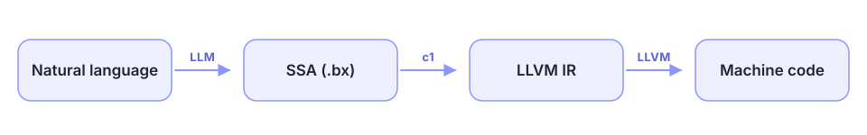

#  codeone

[English](README.md) | [简体中文](README.zh-CN.md)

**codeone is a natural-language compiler and must be used together with AI coding**: an LLM generates SSA directly from natural language, and the compiler lowers that SSA to LLVM IR and native machine code, removing the high-level language layer from the "natural language → high-level language → machine code" chain.



- **SSA compiler (`ssa/`)**: `c1` compiles `.bx` into `.o` and links executables or static libraries. Its 39 instructions cover arithmetic, bitwise, memory, control flow, atomics, target inline assembly and `tensor` (f32 elementwise arithmetic and matrix multiply over static shapes).
- **Two backends**: by default the AST is lowered straight to LLVM IR; `--backend=mlir` routes it through a hand-written MLIR dialect in `ssa/hir/` that mirrors every instruction one-to-one (see [`hir.md`](hir.md)). Both paths run in the same process — MLIR is linked into `c1`, with no helper binary — and `tensor` ops become linalg kernels on either path.
- **Standard library (`ssa/boxes/std/`)**: pure-SSA modules for strings, containers, JSON, time, hashing and ciphers, RSA/ECDSA, TLS 1.2/1.3, HTTP, WebSocket and threads; non-ISO-C system APIs are wrapped in C under `ssa/platform/`.

## AI Coding Required

- **Humans express intent**: describe requirements, constraints and acceptance criteria in natural language, then review the result.
- **AI agents write the code**: Claude Code / Codex CLI / Gemini CLI generate `.bx` through the `codeone` skill and drive `c1` to compile, run and debug.
- **Do not hand-write `.bx`**: writing SSA by hand is like writing assembly and gives up all the benefits of this project.

## Quick Start

Prebuilt toolchains are published as GitHub Releases: **run `install.sh` inside `release/`**:

```bash
git clone https://github.com/jakeyang689/codeone.git
cd codeone/release
./install.sh
source "$HOME/.codeone/env"
```

The installer will:

- download the archive matching this platform from GitHub Releases and install it to `~/.codeone/toolchain/` (`bin/`, `lib/`, `boxes/`, `docs/`)
- create `~/.codeone/env` and add a `source` line to your shell profile, so new shells can use `c1` directly
- install the `codeone` skill for any Claude Code / Codex CLI / Gemini CLI found locally

> Only `aarch64` (Apple Silicon / ARM Linux) toolchains are published for now; build from source on other architectures.
>
> Slow GitHub downloads? Use a mirror prefix: `CODEONE_GH_MIRROR=https://ghfast.top/ ./install.sh`.

Verify the install and create the first project:

```bash
c1 --version

mkdir myapp && cd myapp
/codeone create myapp
```

The scaffold generates `agents.md`, `main.bx`, `Makefile` and `.gitignore`, compiles them to verify the toolchain, and is then ready for natural-language requests through the agent.

## Building from Source

You can skip `release/` and let an AI agent build from source: in the repository root, ask Claude Code / Codex CLI / Gemini CLI to "build the toolchain and install it". The agent follows `build.sh` through the dependency check, the first LLVM build (10–30 min) and incremental builds, then runs `install.sh` to install under `~/.codeone`.

The equivalent manual steps:

```bash
mkdir -p llvm/build
./build.sh --rebuild-llvm     # first run only
./build.sh                    # incremental from then on
./install.sh
```

Requirements: macOS or Linux with `cc`, `clang++`, `make` and `ar`; the first LLVM build also needs `cmake` and `ninja` (`xcode-select --install` on macOS). Build output lands in `toolchain/<target-triple>/`.

## Samples

Two complete applications under [`sample/`](sample/) show what the toolchain can build:

- **[`sample/osone`](sample/osone/)** — a bare-metal `aarch64` kernel written entirely in SSA: MMU with W^X, an in-memory ramfs, virtio network/GPU/input drivers, Ethernet/ARP/IP/ICMP/UDP/TCP with DHCP and DNS, a round-robin scheduler, an interactive shell, a retained-mode GUI and an LLM agent CLI. Built with `c1 --cpu aarch64 --os none` and `ld.lld`, then run under QEMU.
- **[`sample/docsite`](sample/docsite/)** — an HTTPS static-site server built on the standard library's TLS 1.2 server stack: serves `public/` over TLS on port 8443 with access logging, configured entirely through environment variables.
