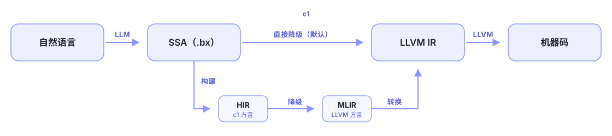

# codeone

[English](README.md) | [简体中文](README.zh-CN.md)

**codeone 是一个自然语言编译器，必须配合 AI coding 使用**：让 LLM 直接从自然语言生成 SSA，再由编译器把 SSA 降级为 LLVM IR 并产出原生机器码，从而省掉「自然语言 → 高级语言 → 机器码」中间的高级语言层。



- **SSA 编译器（`ssa/`）**：`c1` 把 `.bx` 编译为 `.o`，链接为可执行文件或静态库。39 条指令覆盖算术、位运算、内存、控制流、原子操作、目标平台内联汇编，以及 `tensor`（静态形状上的 f32 逐元素运算与矩阵乘）。
- **两套后端**：默认直接把 AST 降级为 LLVM IR；`--backend=mlir` 则先经过 `ssa/hir/` 中手写的 MLIR 方言，它与每条 SSA 指令一一对应（见 [`hir.md`](hir.md)）。两条路径都在同一进程内产出 LLVM IR——MLIR 静态链接进 `c1`，无需辅助程序；`tensor` 指令在两种后端下都会生成 linalg 内核。
- **标准库（`ssa/boxes/std/`）**：纯 SSA 编写的字符串、容器、JSON、时间、哈希与加解密、RSA/ECDSA、TLS 1.2/1.3、HTTP、WebSocket、线程等模块；非 ISO-C 系统 API 由 `ssa/platform/` 的 C 封装提供。

## 必须配合 AI Coding

- **人负责表达意图**：用自然语言描述需求、约束和验收标准，并审查生成结果。
- **AI 代理负责写代码**：Claude Code / Codex CLI / Gemini CLI 通过 `codeone` skill 生成 `.bx`，调用 `c1` 编译、运行和调试。
- **不要手写 `.bx`**：手写 SSA 等同于手写汇编，会失去本项目的全部收益。

## 快速开始

预编译工具链发布在 GitHub Releases 上，**在 `release/` 目录里运行 `install.sh` 即可**：

```bash
git clone https://github.com/jakeyang689/codeone.git
cd codeone/release
./install.sh
source "$HOME/.codeone/env"
```

安装脚本会：

- 从 GitHub Releases 下载与当前平台匹配的归档，安装到 `~/.codeone/toolchain/`（`bin/`、`lib/`、`boxes/`、`docs/`）
- 生成 `~/.codeone/env` 并在 shell 配置中写入 `source` 行，新终端里可直接使用 `c1`
- 为本地已安装的 Claude Code / Codex CLI / Gemini CLI 安装 `codeone` skill

> 目前只发布 `aarch64`（Apple Silicon / ARM Linux）的工具链；其他架构请从源码构建。
>
> GitHub 下载太慢时可用镜像前缀：`CODEONE_GH_MIRROR=https://ghfast.top/ ./install.sh`。

验证安装并创建第一个工程：

```bash
c1 --version

mkdir myapp && cd myapp
/codeone create myapp
```

脚手架会生成 `agents.md`、`main.bx`、`Makefile`、`.gitignore`，并自动编译验证工具链。之后在代理中用自然语言描述需求即可。

## 从源码构建

也可以跳过 `release/`，直接让 AI 代理从源码构建：在仓库根目录对 Claude Code / Codex CLI / Gemini CLI 说一句「构建工具链并安装」，代理会按 `build.sh` 完成依赖检查、LLVM 首次编译（10–30 分钟）和增量构建，再执行 `install.sh` 装到 `~/.codeone`。

手动执行等价于：

```bash
mkdir -p llvm/build
./build.sh --rebuild-llvm     # 仅首次需要
./build.sh                    # 之后增量构建
./install.sh
```

环境要求：macOS 或 Linux，`cc`、`clang++`、`make`、`ar`；LLVM 首次构建另需 `cmake`、`ninja`（macOS 还需 `xcode-select --install`）。构建结果位于 `toolchain/<target-triple>/`。
